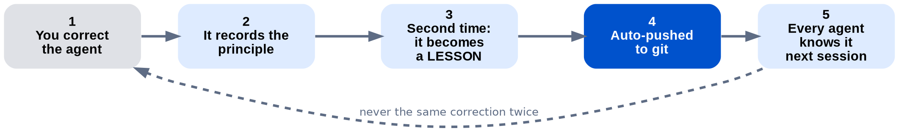
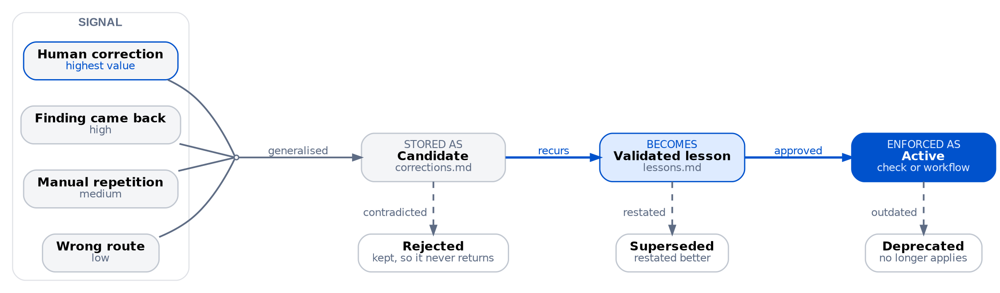
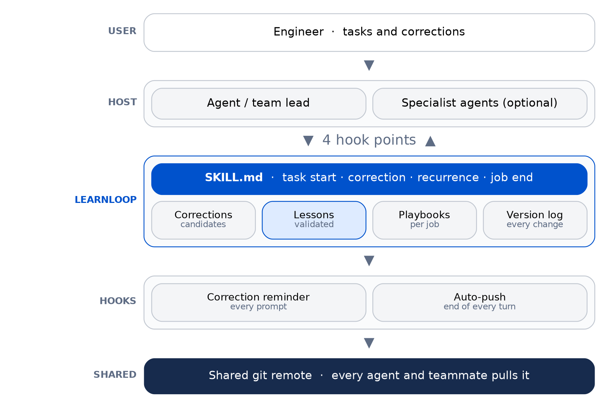
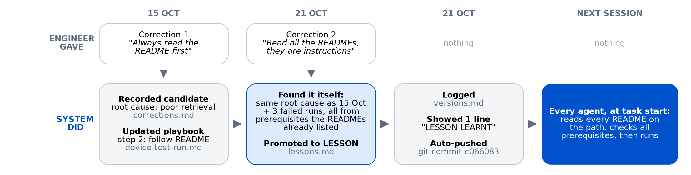
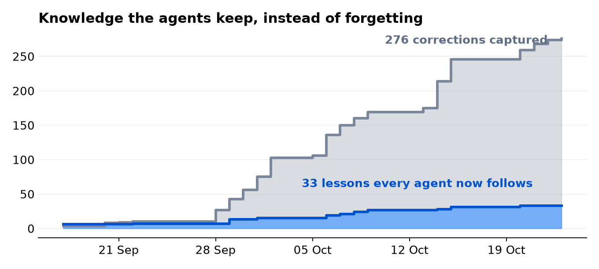
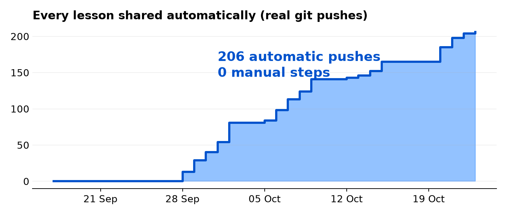
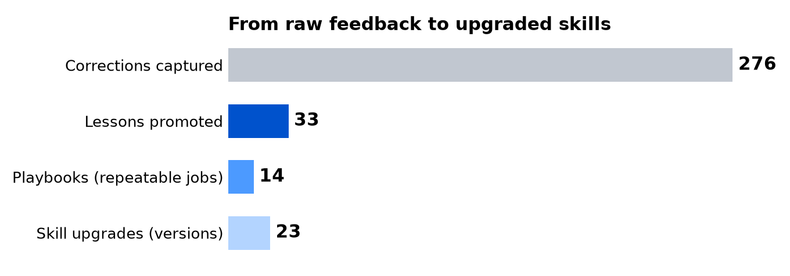
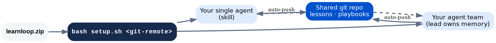

# Self-Improving AI Agents

**A Governed Learning Loop with Automatic Lesson Sharing**

> Correct your AI agent once. Every agent on the team remembers it, automatically.

AI agents forget what you tell them: the same mistake comes back in the next session.
**Learnloop** fixes that. It captures every human correction, turns it into a general lesson
when it happens a second time, and **pushes it automatically to a shared git repository**, so
every agent and every teammate starts the next session already knowing it. Agents can never
change their own rules without a human approving it.

It is a single drop-in skill folder for Claude Code. It works as a standalone skill or as the
memory module of an agent team.

| 33 | 206 | 0 | 1 |
|:-:|:-:|:-:|:-:|
| lessons every agent now follows | automatic git pushes | manual steps to share a lesson | command to set up |

*Figures from the prototype, in daily use by a test-engineering agent team for about five weeks.*

Full design document (Software Design Document, proposal / concept):
[docs/Self-Improving_AI_Agents.docx](docs/Self-Improving_AI_Agents.docx)

---

## The problem

AI coding agents now review code, write tests and triage CI failures. But they have no
memory between sessions. Feedback given on Monday is lost by Thursday, so engineers spend
time correcting the same mistakes again and again, and each person's corrections help only
that person.

## How it works



- **Capture.** Every correction from a person, including each PR review comment, is recorded
  as the principle behind it, not word for word. "Grep the reports" helps once; "check what
  the reviewer reads" helps every time.
- **Promote.** The first time, it is only a candidate. The second time the same correction
  comes up, it becomes a lesson. Requiring recurrence keeps one-off noise out of memory.
- **Share.** A hook commits and pushes the lesson to the shared git repository at the end of
  the turn. No manual step, no review queue.
- **Apply.** At the start of every task, the agent (or the team lead) loads the relevant
  lessons, plus a playbook for repeatable jobs such as a code review or a test run.

## How it learns



| State | Lives in | Changes how the agents work? |
|---|---|---|
| Candidate | `memory/corrections.md` | No, one occurrence only |
| Validated lesson | `memory/lessons.md` | Yes, loaded at task start; auto-pushed |
| Active | a check or a workflow | Yes, enforced; needs human approval |
| Rejected / superseded / deprecated | kept with a reason | No |

## Components



| Component | Responsibility |
|---|---|
| `SKILL.md` | The four hook points the host calls: task start, correction, recurrence, job end |
| `memory/corrections.md` | Candidates: each distinct correction once, with root cause and recurrence count |
| `memory/lessons.md` | Validated principles, loaded at task start |
| `memory/playbooks/` | One learned procedure per repeatable job, updated after each run |
| `evaluation/versions.md` | Log of every lesson, playbook change and approved change |
| `hooks/` | Correction reminder (every prompt) and auto-push (end of every turn) |

## A real example

A real trail from the prototype. The agent team was asked to run a device test suite and,
twice, improvised the run instead of following the documented procedure.



| | Detail |
|---|---|
| What the engineer gave | Two one-line corrections, six days apart: "always read the README first" and "read all the READMEs, they are instructions". No rule written, no file edited. |
| What the system found itself | The second correction had the same root cause as the first (the knowledge existed but was not loaded), and its three failed runs that day all came from prerequisites the READMEs already listed. |
| What it did | Recorded a candidate, updated the test-run playbook, promoted the lesson on recurrence, logged it, showed one line to the engineer, and pushed it. |

| | Before | After |
|---|---|---|
| Planning a test run | From the agent's own guesses | From every README on the path, followed literally |
| Prerequisites | Discovered by failing runs | Checked before the first run |
| Who benefits | The one corrected session | Every agent and teammate, from the next session |

## Results (real data from git)





## Benefits

- **Stop repeating yourself.** A correction given once stays given, in every session.
- **Shared instantly.** Every lesson is auto-pushed; the whole team gets it next session.
- **Faster repeatable jobs.** Each job starts from the last run's playbook, not from scratch.
- **Fewer review rounds.** Reviewer comments become rules the agent applies to the next PR.
- **Safe by design.** Agents never change their own rules without a human approving.
- **Plug and play.** Works as a single skill or inside any agent team. No dependencies.

Good fits: code review, test automation, CI and incident triage, release checklists,
onboarding, and any multi-agent platform.

## Governance

Recording and sharing lessons is automatic. Changing how the agents work (new rules,
checks, agent definitions) needs a human to approve a written recommendation that includes
its evidence and a rollback. Every change is logged. See
[`references/governance.md`](references/governance.md).

## Getting started



```bash
git clone <this repository> learnloop && cd learnloop
bash setup.sh git@github.com:<you>/<your-learnloop-memory>.git
```

`setup.sh` does three things:

1. Copies the skill to `~/.claude/skills/learnloop` (override with `LEARNLOOP_DIR`).
2. Makes that folder a git repository and, if you pass a remote, connects and pushes it.
   This is what makes every lesson push automatically.
3. Merges the two hooks into `~/.claude/settings.json`, keeping your existing hooks and
   saving a backup.

Restart Claude Code afterwards.

- Without a remote, lessons are committed locally until you run `bash setup.sh <remote>` again.
- To share one memory across a team, everyone runs setup with the same remote.
- For an agent team, also paste [`examples/team-lead-snippet.md`](examples/team-lead-snippet.md)
  into the lead agent's instructions.

**Check it works:** give the agent a task, correct the same mistake twice, and look for the
`📚 LESSON LEARNT` line, a new entry in `memory/lessons.md`, and a new commit on your remote.

## FAQ

| Question | Answer |
|---|---|
| Does it edit my other skills? | No. Lessons live in Learnloop's own `memory/`; agents load them at task start. |
| Is it machine learning? | No model is trained. Agents learn from human feedback stored as shared memory. |
| What does auto-push need? | The hooks enabled and the folder in a git repo with a remote. `setup.sh` does both. |

## Repository layout

```
SKILL.md                 the four hook points, record rules, governance
setup.sh                 one-command install
references/              learning, reflection, experience memory, governance
memory/                  corrections (candidates), lessons, playbooks/
evaluation/versions.md   log of every lesson, playbook change and approved change
hooks/                   correction reminder, memory auto-push
examples/                hook settings, team-lead wiring
docs/                    design document and figures
```

## Limitations and next steps

The prototype shows the loop works and shares lessons automatically. It does not yet
measure the time saved: the next step is to measure how often the same correction is needed
per task, before and after adoption, across more teams.
